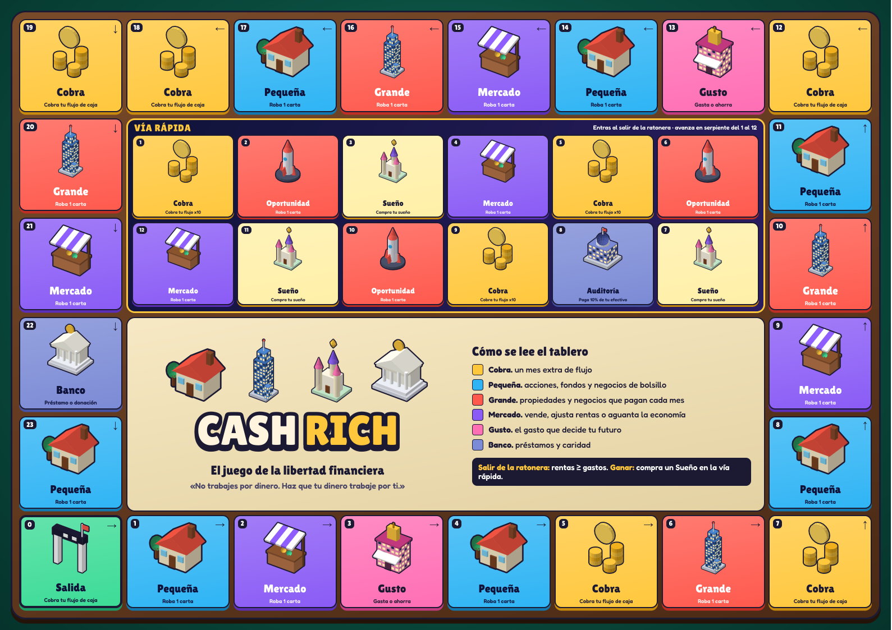
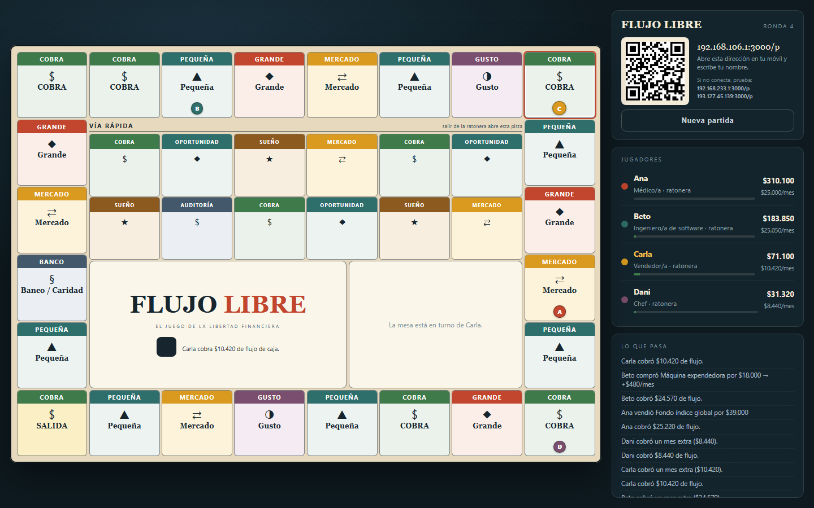
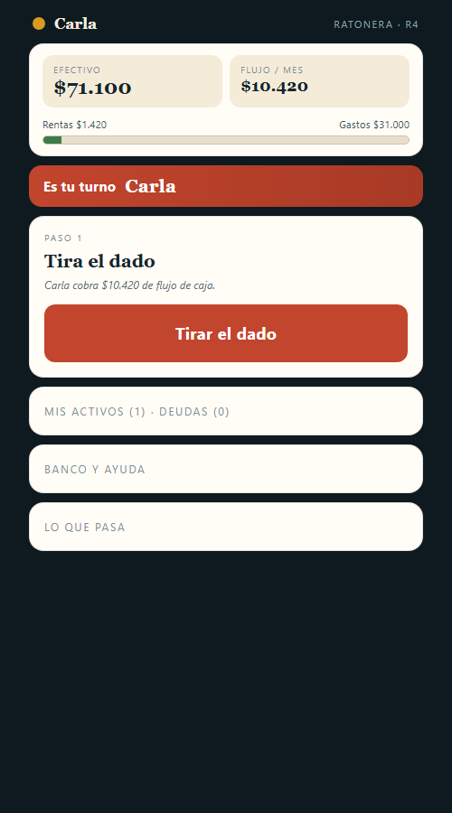

# CashRich — juego de mesa imprimible + versión digital

Juego original de educación financiera para **2 a 6 jugadores** (90–120 min).
Cada jugador empieza con una profesión, un sueldo y una lista de gastos. Gana quien
logre que sus activos paguen su vida y compre su sueño.

> Es un juego **original**, inspirado en el género de juegos de libertad financiera.
> No es una copia ni tiene relación con *Cashflow®* ni con sus autores.



<p align="center">
  
  
</p>

---

## 1. Versión imprimible (PDF)

| Archivo | Qué es | Cómo imprimir |
|---|---|---|
| `CashRich-01-Reglas.pdf` | Reglas completas y modo avanzado (5 páginas) | A4, una cara |
| `CashRich-02-Tablero-A3.pdf` | Tablero | **A3 horizontal**, 100 % |
| `CashRich-03-Cartas.pdf` | 119 cartas con reverso (28 páginas) | A4, **doble cara por el borde largo, 100 %** |
| `CashRich-04-Hoja-Estado-Financiero.pdf` | Hoja de jugador + bitácora | A4, **una por jugador** |
| `CashRich-05-Dinero.pdf` | Billetes del juego | A4, **2 copias** |
| `CashRich-06-Fichas-y-Dado.pdf` | 6 fichas redondas o de pie, dado con pestañas y checklist | A4, una cara |
| `CashRich-07-Ayuda-de-mesa.pdf` | Chuleta de turno (2 por hoja) | A4, una cara |

### Ajustes de impresión

1. Escala **100 %** o "tamaño real". Nunca "ajustar al área de impresión" en las cartas.
2. **Márgenes: ninguno / mínimo**.
3. Activa "imprimir colores de fondo" si tu impresora lo pide.
4. Papel de 180–250 g para tablero y cartas; el resto en papel normal.
5. Si no tienes A3, el tablero se puede imprimir en A4 con "ajustar a página" (queda pequeño pero se juega).

### Cómo se juega en 60 segundos

1. Reparte una **profesión** al azar y llena tu hoja: salario, gastos, efectivo.
2. En tu turno **cobras tu flujo** (salario + rentas − gastos), tiras el dado y avanzas.
3. Las casillas dan **oportunidades**: compras activos que te pagan cada mes.
4. Cuando tus **rentas cubren tus gastos**, sales de la ratonera y entras a la vía rápida.
5. Gana el primero que **compre un Sueño**.

---

## 2. CashRich: la versión digital online

Web en **https://cashrich.xyoncloud.win**, una APK de móvil y una APK de TV.

| Cómo jugar | Qué hace falta |
|---|---|
| **Con TV** | Abre la APK de TV (o `/tv` en un navegador). Crea la mesa sola y muestra un QR. Cada jugador lo escanea y juega en la web desde su móvil, sin instalar nada. La TV no se toca. |
| **Sin TV** | Web o APK de móvil: crea una mesa y comparte el enlace o el código. Cada uno ve el tablero 3D y sus controles. |

El primero en entrar a la mesa es el **admin**: elige dificultad y duración, empieza la partida, puede saltar a quien no responda y lanzar otra partida.

### Reglas de la versión digital

Además de las reglas del juego de mesa:

- **Modos.** Exprés (por defecto: unos 30 min, 12 rondas, gana quien más progresa respecto a su sueldo), Clásico (la partida larga), Reto semanal (mismo azar para todas las mesas, con clasificación; se puede jugar solo) y Aula (rentabilidad de cada oferta a la vista y ficha de reflexión imprimible).
- **Tratos.** En cualquier momento, también fuera de tu turno: vender o comprar activos a otro jugador y prestarse dinero con interés. La hipoteca va con el activo.
- **Informe final.** Evolución del patrimonio, mejor y peor operación, rentas, intereses, gastos y una lección según cómo jugaste.
- **Economía viva.** Expansión, burbuja, recesión y recuperación se suceden. Mueven el precio de inmuebles, bolsa y negocios, las rentas y el tipo de interés.
- **Precios variables.** Cada oferta cuesta según esté su sector, pero su renta no cambia: en recesión todo renta más por lo que pagas.
- **Apalancamiento.** Al vender cobras el valor de mercado menos la hipoteca. En una crisis puedes tener que poner dinero para deshacerte de un activo.
- **Crédito.** El interés se fija el día que pides el préstamo: pedir en recuperación sale mucho más barato que en recesión.
- **Subastas a ciegas.** Si pasas de una oferta, los rivales pujan 20 segundos con su efectivo y tú te quedas lo que paguen por encima del precio.
- **Operaciones.** En tu turno puedes vender a precio de mercado o mejorar un activo (cuesta el 25 % de su valor; renta un 35 % más y vale un 25 % más).
- **Bonos de cartera.** Tres activos de un sector: +20 % en sus rentas. Uno de cada sector: +10 % en todas.
- **Dificultad.** Fácil, normal o difícil (menos efectivo, crédito más caro, mercados más violentos, meta de rentas del 125 % y sueños un 50 % más caros).
- **Duración.** Sin límite gana quien compre su sueño; con 12, 20 o 30 rondas gana el mayor patrimonio si nadie lo compra antes.

### Desplegar en Coolify

1. Nuevo recurso → repositorio `mkandreum/cashrich`, rama `main`, tipo **Docker Compose** (usa `docker-compose.yml`).
2. Asigna el dominio `https://cashrich.xyoncloud.win` al servicio `app` (puerto 3000).
3. Activa el despliegue automático. No necesita variables de entorno. Las mesas se guardan en el volumen `flujo-data` y sobreviven a cada despliegue.

### APK

GitHub Actions compila `CashRich-movil.apk` y `CashRich-tv.apk` en cada cambio de `android/`; una etiqueta `v1.0.0` las publica en una Release. Para que las versiones se instalen unas encima de otras, añade los secretos `KEYSTORE_B64`, `STORE_PASSWORD`, `KEY_ALIAS` y `KEY_PASSWORD`.

### Desarrollo

```
cd web
npm install
npm run dev      # servidor y cliente con recarga
npm test         # reglas del juego
npx tsx tools/simulate.ts 1000 4   # mide duración y equilibrio; solo es una herramienta, el juego no tiene bots
```

```
web/
  server/          motor del juego, mesas y API en tiempo real (SSE)
  src/             cliente React; el tablero 3D está en lib/scene3d.ts
  shared/          modelos 3D compartidos por la web y las APK
  data.json        cartas y tablero exportados del juego de mesa
android/           app nativa en Kotlin, Compose y OpenGL
```

Tras cambiar `data.json` o los iconos, regenera el código de Android con `node android/tools/gen-assets.mjs <node_modules con lucide-react y opentype.js>`.

---

## 3. Volver a generar todo

Fuentes en `src/` (Python + HTML/CSS, sin dependencias):

```
cd src
python print_cashrich.py # genera los HTML de impresión
python render.py         # los convierte a PDF (usa Chrome)
python export_json.py    # actualiza web/data.json para la versión digital
```

Editar `game_data.py` cambia **las dos versiones** a la vez: cartas, precios, tablero y textos.

### Balance

`BIG_MULT` y `SMALL_MULT` en `game_data.py` ajustan cuánto paga cada activo.
Con los valores actuales una partida dura unas 12–18 rondas. Si quieres partidas más
largas, bájalos; más cortas, súbelos.

---

## 4. Licencia de uso

Material original creado para este proyecto. Puedes imprimirlo, jugarlo y usarlo en
talleres o clases. Si lo compartes, cita la fuente y no lo vendas.
